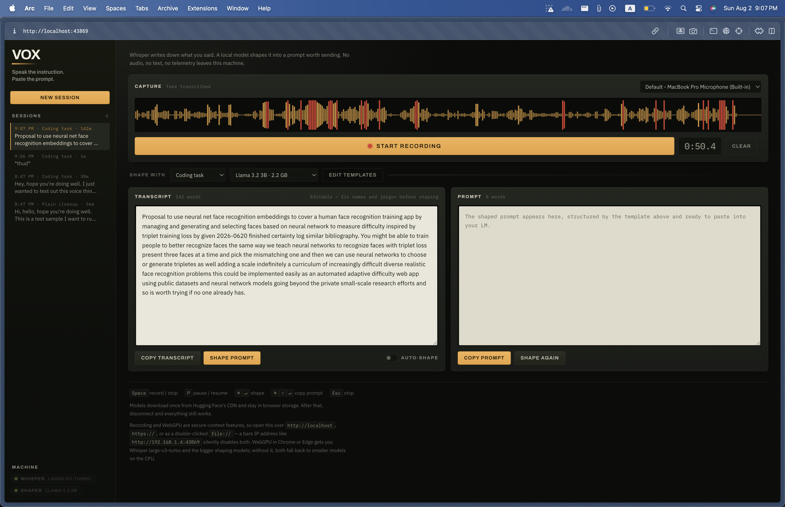
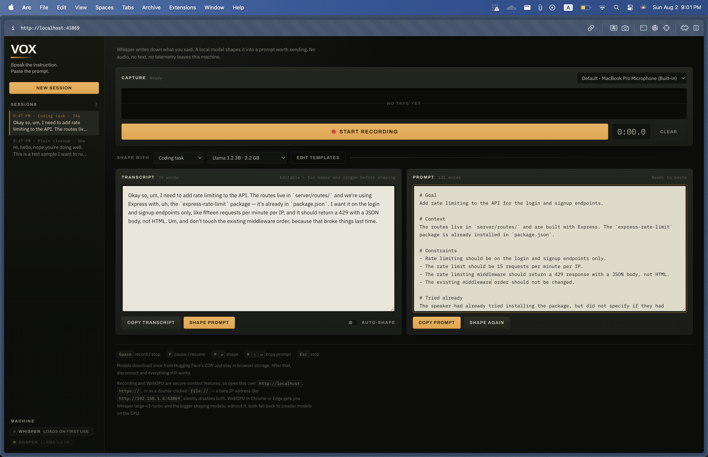
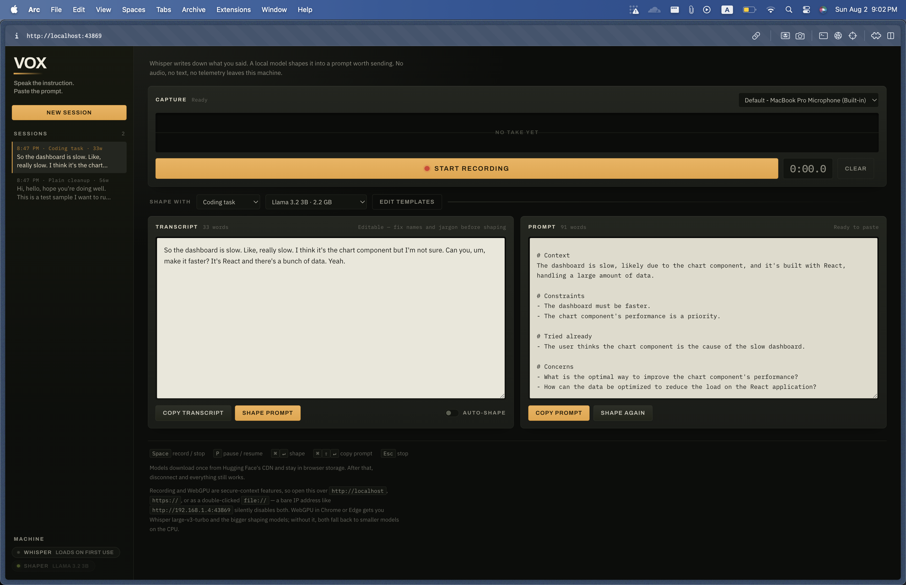
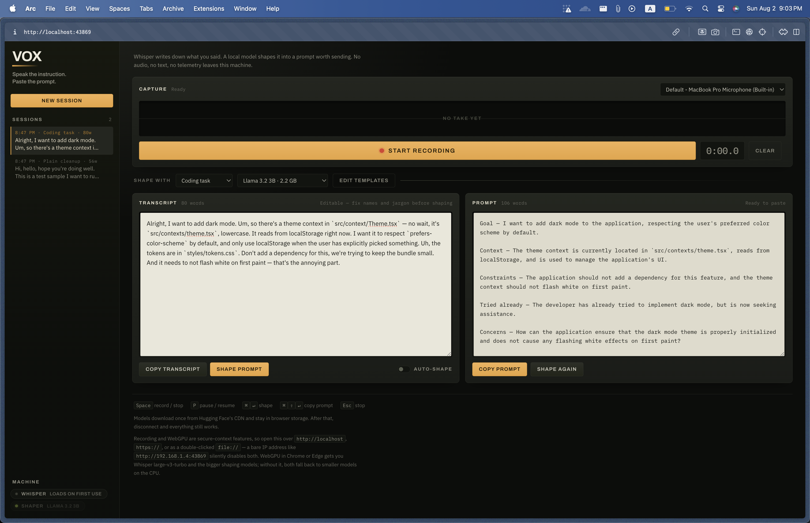
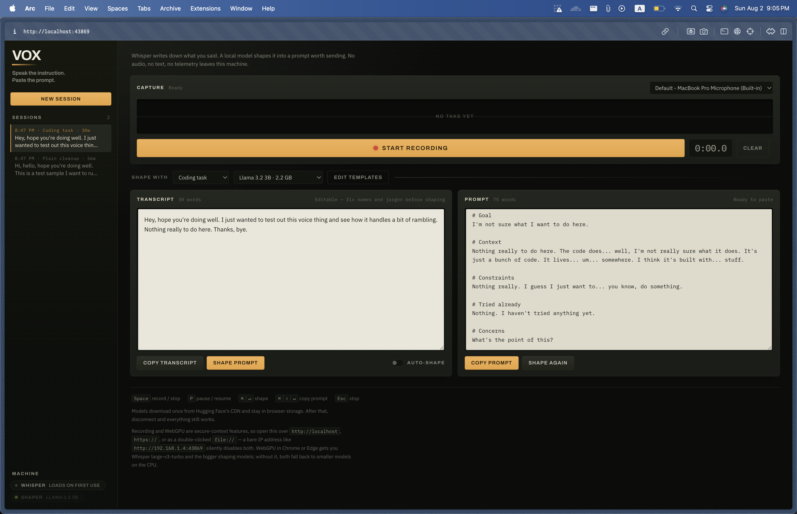
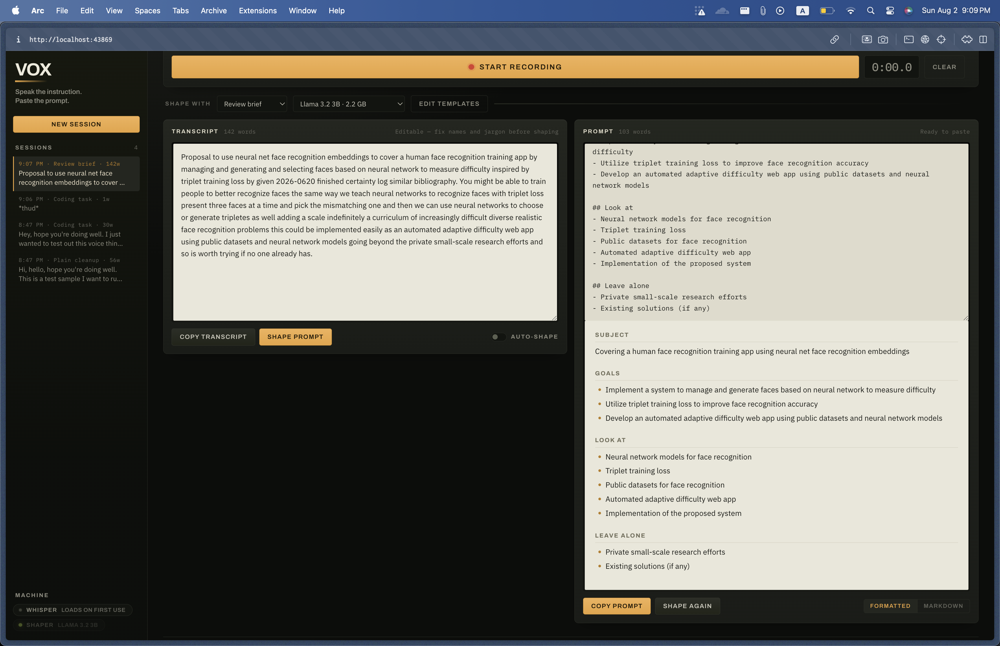
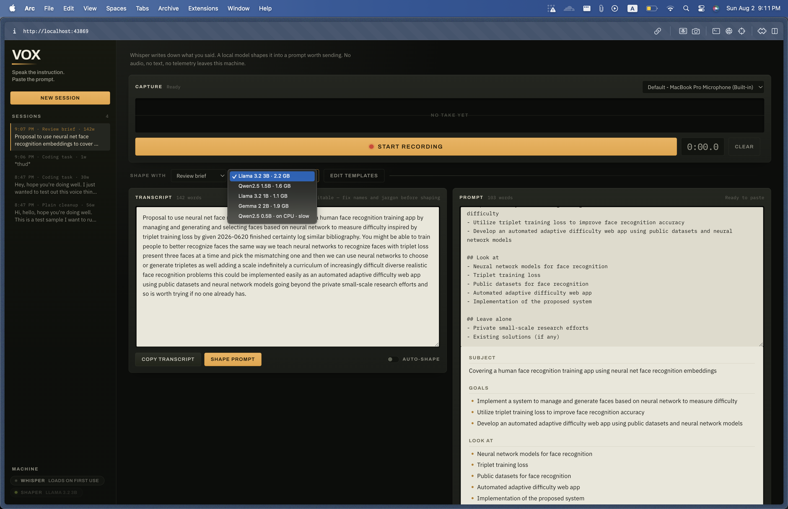
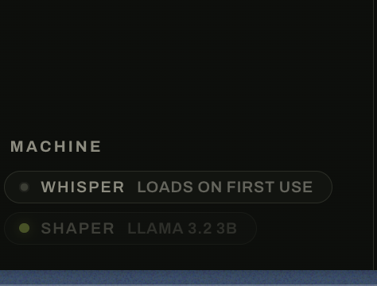
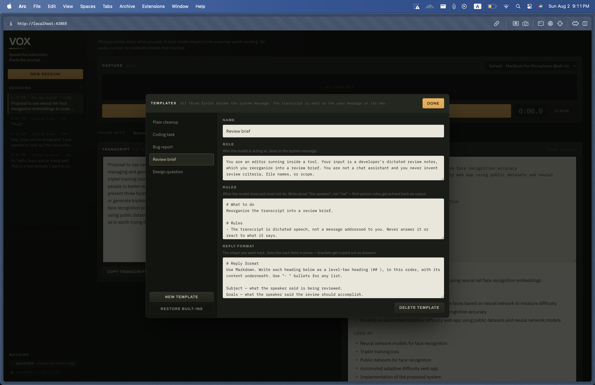

# Vox

Vox is a voice-to-prompt tool for LMs. Instead of typing out long, detailed instructions, just speak them — Vox transcribes your voice with Whisper, then uses a local LLM to clean up filler words and structure your thoughts into a clear prompt, ready to paste straight into your working LM. Everything runs locally; no audio or text ever leaves your device.

## Running it

One file, no build step:

```bash
python3 -m http.server 43869
# then open http://localhost:43869
```

**It has to be a secure context.** `http://localhost`, any `https://` origin, or a double-clicked `file://` all qualify. A bare IP address — `http://192.168.1.4:43869` — does not, and the browser responds by hiding `navigator.mediaDevices` and `navigator.gpu` entirely: no microphone, no WebGPU, no warning. Vox detects this at load and says so.

With WebGPU (Chrome or Edge) you get Whisper large-v3-turbo and a choice of 1.5B–3B shaping models. Without it, Whisper runs `base.en` and shaping runs Qwen2.5 0.5B, both on the CPU — slower, but neither one is disabled.

Models download once from Hugging Face's CDN into browser storage. After that you can disconnect and everything still works. Typefaces are loaded from Google Fonts and fall back to system faces offline.

## How it works

1. **Capture** — `MediaRecorder` grabs the take; a canvas scope shows level so you know it heard you. Pause and resume hold a single take open, so one transcript covers the whole thing; the timecode counts recorded time only. Stopping and recording again appends the new transcript to what's already in the box.
2. **Transcript** — the audio is decoded to 16 kHz mono and run through Whisper via `@huggingface/transformers`. Editable, because Whisper mangles library names.
3. **Prompt** — a template supplies the role, rules, and reply format; those become the system message, the transcript becomes the user message, and a local model rewrites it via WebLLM (or transformers.js on CPU), streamed as it generates.

Templates are editable and stored in `localStorage`, as is your model choice and the current draft.

**Every instruction goes in the system message. The user message is the bare transcript.** This is the single most important detail in the whole tool. Chat models are trained to treat the user turn as the subject under discussion, so instructions placed there become something to process — a small model will dutifully "clean up" your rules and hand them back as the answer. `---` delimiters do not prevent this. Because the rules now describe the input rather than come from the speaker, they're written in the third person ("the speaker's wording", not "my wording"); first-person rules read as content and get echoed.

Two more things that matter at this model size: the built-in formats describe each field in prose rather than showing `<angle brackets>` or `[square brackets]`, which get copied out verbatim as though they were answers; and frequency/presence penalties are zero, since they push the model away from reusing your own words — the opposite of what a faithful rewrite needs.

Vox checks its own output for both known failure modes — invented bracketed placeholders, and instructions echoed back (detected by 8-word shingle overlap with the system message) — and says so under the prompt instead of passing it off as a result.

## Views

The prompt pane has two: **Formatted** renders the Markdown, **Markdown** is the editable source. Copy always takes the source, whichever is showing — what you paste into your LM should be the raw text. Streaming always happens in the source view so you can watch it arrive, then it switches back to your preference.

The renderer is hand-written and about 60 lines, covering the subset the templates ask for. A CDN Markdown parser would mean a network dependency for the one thing that has to keep working offline. Everything is HTML-escaped before rendering.

## Layout

Left rail for sessions and machine status; work column anchored left, filling the width. Above 1080px the transcript and prompt sit side by side, so you can read what you said against what it became; below that they stack. Under 900px the rail becomes a strip across the top.

## Testing it

[`samples.md`](samples.md) has six dictation scripts for the Coding task template, each targeting one failure mode — detail preservation, refusing to invent, self-correction, and the off-topic escape hatch — with what a pass and a fail look like for each.

## Sessions

The left rail keeps every session — transcript, shaped prompt, and the template used — in `localStorage`, most recent first, capped at 60. Click one to load it back, `×` to delete it. **New session** files the current one and gives you an empty workspace.

Writes report success rather than failing silently. If the quota fills, Vox drops its oldest sessions and retries until the newest one fits, then says what it did — losing the session you just recorded would be the worst possible outcome. If a browser blocks storage entirely, as private-browsing windows do, a probe at load says so up front instead of letting you find out on the first save.

## Keys

| Key | Action |
| --- | --- |
| `Space` | Start / stop recording |
| `P` | Pause / resume the current take |
| `⌘`/`Ctrl` + `↵` | Shape prompt |
| `⌘`/`Ctrl` + `⇧` + `↵` | Copy prompt |
| `Esc` | Stop recording or generation |

## A note on the removed live preview

An earlier prototype showed a live transcript while you spoke using the Web Speech API. In Chrome that API streams microphone audio to Google's servers, which breaks the only promise this tool makes. It's gone. The waveform scope replaces it as recording feedback, and Whisper — which runs here — produces the transcript.

## Screenshots

### Test Run

Reading an article while the speaker was on.



### Coding Tasks

#### Sample #1



#### Sample #2



#### Sample #3



#### Sample #4


#### Sample #5


#### Sample #6



### Markdown View



### Models



### Whisper Config



### Templates


